

  

  

  

  <a href="https://haywireag.com"></a>

  

  

  <a href="https://www.bloomberg.com/oddlots"></a>

  

  

  

  

  

  

  

  

  
  
  <a href="https://x.com/aidenjohnsonn_"></a>
  

  

